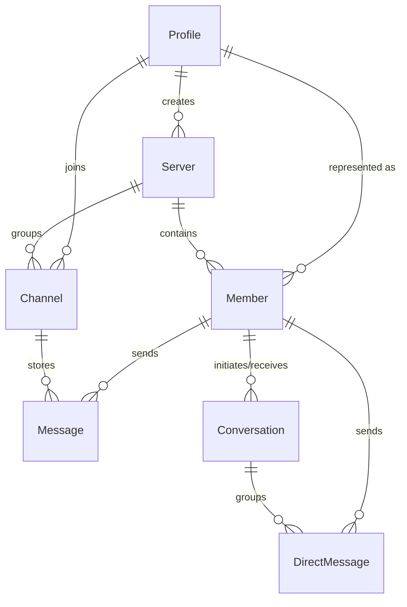

# 🎙️ WaveTalk

WaveTalk is a full-stack, real-time community communication platform inspired by Discord. It allows users to build communities (Servers), organize them into dedicated text, audio, or video channels, exchange direct messages, upload file attachments, and participate in low-latency WebRTC-based audio and video calls.

---

## ✨ Features

- **🛡️ Secure Authentication**: Integration with **Clerk** supporting login, signup, social logins, and secure route protection.
- **💬 Real-Time Text Chat**: Powered by **Socket.io** for instant messaging, complete with:
  - Message creation, live editing, and soft-deletion.
  - Image and file attachments (PDFs, docs, etc.).
  - Emoji picker support.
  - Real-time message status updates.
- **🔊 Low-Latency Voice & Video**: WebRTC streaming powered by **LiveKit** enabling:
  - Crystal-clear 48kHz stereo audio channels.
  - Low-latency HD video call rooms.
  - Speaker detection and active volume indicator states.
- **👥 Direct Messaging (DMs)**: Establish 1-on-1 conversations between server members with full direct messaging support.
- **🎨 Server & Channel Organization**:
  - Create, customize, edit, and delete servers with custom icons.
  - Organize servers into **Text**, **Audio**, and **Video** channels.
  - Interactive server discovery and search filters.
- **🔑 Member Role & Access Control**:
  - Server invitation system via secure, unique invite links.
  - Role-based permissions (`ADMIN`, `MODERATOR`, `GUEST`).
  - Member management panel (Kick, Change Roles) for Admins.
- **📁 Secure Media Uploads**: Built-in integration with **Uploadthing** for avatar, server icon, and chat attachment storage.
- **✨ Clean UI & UX**: Modern desktop-inspired layout using a refined, responsive design, responsive sidebars, skeleton loaders, and modern animations.

---

## 🛠️ Tech Stack

### Frontend
- **Framework**: [Next.js 16 (App Router)](https://nextjs.org/) & [React 19](https://react.dev/)
- **State Management**: [Zustand](https://zustand-demo.pmnd.rs/) (Client state) & [TanStack React Query v5](https://tanstack.com/query/latest) (Server state & caching)
- **Styling**: [Tailwind CSS v4](https://tailwindcss.com/) & [Radix UI Primitives](https://www.radix-ui.com/)
- **Icons**: [Lucide React](https://lucide.dev/)
- **Forms**: [React Hook Form](https://react-hook-form.com/) with [Zod Validation](https://zod.dev/)

### Backend & Real-Time
- **Server**: Next.js Server Actions & API Routes
- **WebSockets**: [Socket.io](https://socket.io/) (via Next.js custom Socket routing)
- **WebRTC**: [LiveKit React Components](https://livekit.io/) & LiveKit Server SDK

### Database & Storage
- **ORM**: [Prisma Client](https://www.prisma.io/)
- **Database**: Serverless PostgreSQL via [Neon DB](https://neon.tech/)
- **Storage**: [Uploadthing API](https://uploadthing.com/)

---

## 📂 Database Schema Overview

The database models are designed using Prisma to represent servers, channels, direct communication, and roles:



- **`Profile`**: Links to authenticated Clerk users; contains general user metadata.
- **`Server`**: Groups channels and members together. Owned by a Profile creator.
- **`Member`**: Ties a `Profile` to a `Server` with a specific `MemberRole` (`ADMIN`, `MODERATOR`, `GUEST`).
- **`Channel`**: A community stream belonging to a `Server` with a `ChannelType` (`TEXT`, `AUDIO`, `VIDEO`).
- **`Message`**: Text chats sent in a text channel, supports attachments and soft deletes.
- **`Conversation`**: Links two members in a direct messaging relationship.
- **`DirectMessage`**: Messages sent inside private conversations.

---

## 🚀 Getting Started

### 📋 Prerequisites
Make sure you have [Node.js](https://nodejs.org/) installed (v18.x or higher is recommended) alongside `npm`, `yarn`, `pnpm`, or `bun`.

### ⚙️ Installation

1. **Clone the repository:**
   ```bash
   git clone https://github.com/your-username/wave-talk.git
   cd wave-talk
   ```

2. **Install dependencies:**
   ```bash
   npm install
   ```

3. **Configure Environment Variables:**
   Copy the example environment template file and fill in your keys:
   ```bash
   cp .env.example .env
   ```
   Provide credentials for the following services:
   - **Clerk Auth**: Keys from your Clerk Dashboard.
   - **Neon Database**: A PostgreSQL connection string (`DATABASE_URL`).
   - **Uploadthing**: Your API token for file uploads.
   - **LiveKit Cloud**: API credentials and WebSocket URL for WebRTC rooms.

4. **Initialize Database Schema:**
   Generate the Prisma Client types and sync your PostgreSQL database:
   ```bash
   npx prisma generate
   npx prisma db push
   ```

5. **Start the Development Server:**
   ```bash
   npm run dev
   ```
   Open [http://localhost:3000](http://localhost:3000) in your browser to view the application.

---

## 📦 Production & Deployment

### Build the Application
To compile an optimized production build:
```bash
npm run build
```

### Start the Server
To run the built production server locally:
```bash
npm run start
```

### Linting
To check and format the codebase:
```bash
npm run lint
```
